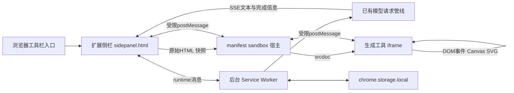

# 在浏览器扩展中实现交互式 UI

本文说明怎样把大模型生成的 HTML/CSS/JavaScript，在 Manifest V3 浏览器扩展内变成可操作、可保存、可继续对话的工具。运行机制以 SPACE AI 1.0.7（`94a8f5d`）为基线，当前1.0.8已接入新版侧栏与工具卡片，见第14节和[本次验收](ai-ui.md)。日期为2026-10-14。

这里讨论的是**扩展内的运行机制**。独立的 [界面预览](design/space-ai-ui-preview.html) 只演示外观；它不承担扩展隔离、后台存储或模型请求。本指南与 [完整架构说明](space-ai-interactive-ui-architecture.md) 配合使用，后者详细列出图表规范、配额、安全和验收。

## 1. 浏览器扩展中的职责分配

模型返回的代码本质上是文本。要产生交互，必须交给浏览器的文档解析与脚本执行环境：HTML生成DOM，CSS决定布局，JS注册事件、修改数据、重绘图表。Markdown代码高亮只展示文本，不会替你执行这些动作。

SPACE AI 把这件事放在隔离的子页面中，保留扩展主页面的权限边界。



| 运行位置 | 能做什么 | 不承担什么 |
| --- | --- | --- |
| `sidepanel.html` + `sidepanel.js` | 聊天DOM、可信工具按钮、Provider选择、创建sandbox iframe | 不在自己的文档里执行模型脚本 |
| `background.js`，MV3 Service Worker | 模型请求、聊天归属、状态验证与写入 | 不绘制Canvas，也不使用DOMParser生成工具页面 |
| `native-host.html` | 运行打包控制器，校验并转发消息，创建子文档 | 不把扩展API或模型密钥提供给生成页面 |
| 工具子iframe的`srcdoc` | 执行生成JS，输入/点击交互，绘图，调用生命周期SDK | 不能直接使用扩展存储、当前网页DOM或模型发送接口 |
| Content Script | 已有网页阅读、选择等页面接入能力 | 本功能不依赖向任意网页注入模型脚本 |

侧栏是扩展自己的页面，不是当前网站的一个普通DIV。页面切换与内容提取是另外的能力，不应为了渲染工具就把生成代码注入正在访问的网站。

## 2. Manifest V3 如何声明

实际构建后的关键配置如下。此处只摘出相关字段，**不能作为整个SPACE AI manifest的替代文件**；其余已有权限、来源和功能仍由构建配方保留。

```json
{
  "manifest_version": 3,
  "background": {
    "service_worker": "background.js",
    "type": "module"
  },
  "side_panel": {
    "default_path": "sidepanel.html"
  },
  "sandbox": {
    "pages": [
      "lib/space-ai-ui/sandbox.html",
      "lib/space-ai-ui/native-host.html"
    ]
  }
}
```

使用侧栏能力需要现有 `sidePanel` 权限，保存工具快照需要 `storage`。当前功能没有新增一个“执行任意模型代码”的浏览器权限。[Side Panel API 官方说明](https://developer.chrome.com/docs/extensions/reference/api/sidePanel) 解释了默认入口及侧栏与扩展API的关系；SPACE AI 保留上游侧栏打开逻辑。

`content_security_policy` 分为两部分：

- `extension_pages`：保留当前主扩展策略，`frame-src 'self'`允许本地宿主页；不允许模型在主页面运行内联JS。
- `sandbox`：单独允许宿主需要的内联脚本，限制网络、资源、frame、表单等能力。完整字符串见 [ai-ui-patch.mjs](../extensions/space-browsa/ai-ui-patch.mjs)。

`wasm-unsafe-eval`是现有主扩展策略中的Wasm能力，不等于给模型开放普通JS的`eval`。不要为“让模型代码运行”把主页面改成允许任意内联脚本。[Chrome CSP说明](https://developer.chrome.com/docs/extensions/reference/manifest/content-security-policy) 说明了这两类页面策略的区别。

## 3. 源文件与构建产物的对应

SPACE AI 通过可追踪补丁适配固定上游，不直接提交一份手改的完整上游副本。

```text
可维护配方                           构建后的扩展目录
extensions/space-browsa/
  ai-ui-patch.mjs                 ->  sidepanel.js / manifest.json 接入
  tool-state-patch.mjs            ->  background.js / lib/storage.js 接入
  tool-revisions-patch.mjs        ->  聊天handler中的父工具关系
  ai-ui/
    panel.js                     ->  lib/space-ai-ui/panel.js
    panel.css                    ->  lib/space-ai-ui/panel.css
    sidebar.css                  ->  lib/space-ai-ui/sidebar.css
    tool-prompt.mjs              ->  lib/space-ai-ui/tool-prompt.js
    protocol.mjs                 ->  lib/space-ai-ui/protocol.js
    runtime.mjs                  ->  lib/space-ai-ui/runtime.js
    native-host.html             ->  lib/space-ai-ui/native-host.html
    native-host.js               ->  lib/space-ai-ui/native-host.js
    tool-state.mjs               ->  lib/space-ai-ui/tool-state.js
    tool-state-background.js     ->  lib/space-ai-ui/tool-state-background.js
```

`.mjs`到`.js`的复制/变换由构建脚本完成。runtime中的公开构建函数会变为宿主页加载的普通函数；后台状态模块的import路径也会换成包内路径。只复制一份panel.js，缺少这些构建步骤，并不能得到完整功能。

## 4. 把模型回复接到侧栏

### 4.1 模型请求走既有后台管线

用户问题、工具生成提示、已有草稿和附件进入现有聊天请求。API鉴权留在受控的请求路径里，生成HTML不接收API Key。

模型SSE片段先用于聊天文本展示；上游客户端可能把`reasoning_content`包成`<thinking>`区段。正式结束后，聊天handler持久化assistant消息，并在DONE事件携带完整原文、稳定消息ID、父工具ID和截断标记。

### 4.2 DONE后挂载

接入点的核心顺序是：

```js
// 当前构建配方注入的DONE接入片段；r是既有聊天渲染器。
await r(finalText, true);
if (el.isConnected) {
  await mountAiUi(el, finalText, m, {
    sendResult: sendSpaceToolResult,
    captureContext: captureSpaceToolContext
  });
}
```

`mountAiUi`先检查取消/截断，再通过共享协议提取唯一的完整工具HTML。它不会拿高亮后的`<code>`节点作为执行来源。没有工具的普通回复仍按聊天文本处理；旧声明式程序进入legacy路径。

历史重开也要走相同挂载流程。只在流式结束时追加一个iframe，会造成新回复能操作、历史却只剩源码的缺陷。

### 4.3 保留完整源码与可执行条件

明确的`space-ui`代码块表示工具；实际模型返回`html`时，必须包含工具meta、SDK调用或旧程序声明。思考草稿、引用例子、未闭合围栏、重复工具和超限源码不能混进最终运行内容。

前端展示与后台源哈希校验必须调用同一个解析器，否则保存时可能发现它们认定的HTML不是同一份。

## 5. 侧栏怎样创建隔离页面

下面摘出 [panel.js](../extensions/space-browsa/ai-ui/panel.js) 的核心创建顺序。生产代码还包含加载并发守卫、超时、清理、错误反馈和状态校验，不能省略这些保护后直接当成等价实现。

```js
const loaded = await stateCall('LOAD');
lease = loaded.lease;
instance = crypto.randomUUID();

frame = document.createElement('iframe');
frame.title = 'HTML/CSS/JS 隔离工具';
frame.setAttribute('sandbox', 'allow-scripts');
frame.referrerPolicy = 'no-referrer';
frame.src = chrome.runtime.getURL('lib/space-ai-ui/native-host.html');

frame.addEventListener('load', () => {
  frame.contentWindow.postMessage({
    type: 'SPACE_TOOL_INIT',
    version: 3,
    instance,
    html: parsed.html,
    state: loaded.state
  }, '*');
}, { once: true });
box.append(frame);
```

顺序不能倒置：先验证消息与源哈希并LOAD本工具状态，再创建实例，等宿主加载后INIT。实例ID用于区分新旧frame；后台租约用于拒绝旧实例迟到的存储写入，它们不是同一个字段。

因为sandbox来源为opaque origin，`postMessage`目标使用`'*'`。安全性来自受限的Window引用、消息来源、实例、请求ID和精确schema检查，不能因为使用了`'*'`就省略接收端验证，也不能把`origin === 'null'`当成认证。

## 6. 宿主怎样让HTML、CSS、JS运行

`native-host.html`加载包内的`runtime.js`和`native-host.js`，并拥有一个仅允许scripts的子iframe。收到合法INIT后：

```js
// 宿主控制器的核心操作。
tool.srcdoc = buildToolDocument(d.html, d.state, instance);
```

`buildToolDocument`在有DOM的sandbox宿主中执行：

1. 用DOMParser把原始HTML解析为文档。
2. 删除模型自带的meta刷新、base、外链脚本和link。
3. 在head最前面加入更严格的子页面CSP。
4. 接着加入可信生命周期SDK的内联bootstrap。
5. 序列化为完整HTML，交给子iframe的srcdoc。

浏览器加载这个子文档时，SDK先安装，模型自己的脚本后执行，因此模型可以直接调用`window.spaceTool`。普通的`<style>`生效，`<script>`注册事件并运行计算。主聊天页面仍只显示经过消毒的说明和折叠源码。

不要试图用`chrome.scripting.executeScript`或主页面`eval`达到同样目的；当前实现不走这些通道。

### bootstrap中的快照转义

保存数据可能包含`</script>`。把JSON直接插入script标签会有提前结束脚本的风险，所以bootstrap把`<`转为`\u003c`，并只允许有限JSON快照。相关回归在`tests/tool-runtime.test.ts`。

## 7. 页面事件怎样变成图表交互

以振幅滑块为例，整个交互发生在生成工具自己的子文档里，不必为每次拖动请求模型：

```js
amplitudeInput.addEventListener('input', () => {
  state.amplitude = Number(amplitudeInput.value);
  drawChart(state);                 // 用Canvas/SVG更新画面
  updateResult(state);              // 更新待分享语义结果
  queueApplicationSave(state);      // 有限节流，再调用SDK保存
});
```

`drawChart`、`updateResult`、`queueApplicationSave`是应用自行实现的函数，不是扩展已有图表API。数据经过输入校验后，Canvas context重绘像素，SVG则更新属性或节点；浏览器事件循环处理下一次输入。

图表应用内部至少区分：

- 可重建的参数和数据：振幅、频率、数据窗口、单位、来源。
- 持久视图：缩放范围、选区、序列显隐、相位。
- 瞬态对象：Canvas context、鼠标位置、tooltip DOM、RAF句柄，不序列化。

放大导致子页面viewport变化，应用用ResizeObserver调整Canvas像素尺寸和坐标布局，再按同一份state重绘。宿主不能跨来源读写内部DOM来强制“修好图表”。主扩展自带ECharts vendor，也不表示子文档里自动存在`window.echarts`。

曲线缩放、刷选、图例联动和命中检测的完整处理规范见 [架构说明第6节](space-ai-interactive-ui-architecture.md#6-图表类工具设计)。

## 8. 交互数据怎样穿过扩展边界保存

工具只调用受限SDK：

```js
await spaceTool.saveState({
  schemaVersion: 1,
  amplitude: state.amplitude,
  frequency: state.frequency,
  xRange: state.xRange,
  phase: state.phase
});
```

SDK复制并校验可序列化数据，合并高频修改，按序号发SAVE。宿主检查发送者是当前子iframe、origin为null、版本/实例/字段合法、负载大小和频率符合限制，再转给侧栏。

侧栏核对消息来自当前宿主后，加入**侧栏持有**的消息ID、源哈希和租约，转成扩展内部消息：

```js
const reply = await chrome.runtime.sendMessage({
  type: 'SPACE_TOOL_STATE',
  op: 'SAVE',
  messageId: message.spaceToolMessageId,
  sourceHash,
  lease,
  state: snapshot
});
if (!reply?.ok) throw new Error(reply?.error || '状态保存失败');
```

生成代码不能自行指定另一个messageId去读写其它工具。它只有SAVE快照消息，没有通用runtime请求转发接口。

后台的注册方式见 [tool-state-background.js](../extensions/space-browsa/ai-ui/tool-state-background.js)：

```js
chrome.runtime.onMessage.addListener((message, sender, respond) => {
  if (message?.type !== 'SPACE_TOOL_STATE') return;
  if (!isTrustedToolSender(sender, chrome.runtime)) {
    respond({ ok: false, error: '工具状态访问被拒绝。' });
    return;
  }
  store.handle(message).then(
    data => respond({ ok: true, data }),
    error => respond({ ok: false, error: '工具状态保存失败，请重试。' })
  );
  return true;
});
```

这是简化展示；实际代码对已知ToolStateError保留可理解的错误原因。`return true`用于保持本次异步消息响应通道，不能误写成先返回成功、稍后才保存。[扩展消息机制](https://developer.chrome.com/docs/extensions/develop/concepts/messaging) 是这段接口的官方依据。

后台继续验证当前历史中唯一合法消息、源码SHA256、当前租约、快照schema和配额，串行写入`chrome.storage.local`。成功确认再逐层返回给SDK，`saveState()`的Promise才resolve。

## 9. 为什么重开、重载后还能恢复

Manifest V3 的Service Worker不是常驻进程，浏览器可以终止空闲worker，之后再按事件唤醒。不要把聊天归属和已确认快照只放在模块全局变量；持久数据放`chrome.storage.local`，worker每次操作按受限key读取并校验。依据见 [Service Worker生命周期](https://developer.chrome.com/docs/extensions/develop/concepts/service-workers/lifecycle)。

恢复流程是：

```text
重新打开侧栏
→ 读取历史，准备稳定assistant消息ID
→ 对每条可运行工具重新解析原始HTML
→ 按消息ID和源哈希LOAD快照，取得新租约
→ 创建宿主与子iframe，把快照作为bootstrap初始值
→ 应用await loadState()后建立自己的state与事件监听
→ 重绘当前结果，动画保持暂停
```

不是恢复旧的JS执行堆栈。闭包、监听器、context和循环重新创建；用户参数、选区、模拟位置等靠应用JSON恢复。归档和当前历史共同决定快照保留；删除全部消息引用后才回收。

同一工具被新的实例LOAD后，旧实例的租约过期，旧实例不能覆盖新实例保存的结果。若未来要多窗口同时编辑同一个工具，需要另做冲突合并，当前策略不是实时协作协议。

## 10. 放大和收起分别做什么

**放大**只给同一个外侧工具容器添加布局class，iframe本身不换、不重新设置src或srcdoc。内部Canvas收到尺寸变化后重绘，因此不会因为放大就重新执行初始化或丢失进度。

**收起**会请求CLOSE：SDK先暂停普通定时器和RAF，调用应用暂停钩子，刷出快照并等待确认；外侧收到CLOSED后移除iframe。重开建立新实例并恢复已保存数据。

正常收起能等待保存，意外崩溃只能恢复最近确认快照。外侧“停止”不能保证打断任意同步死循环；它不是浏览器提供的独立进程强杀接口。

## 11. 工具结果怎样交给AI

生成工具调用：

```js
spaceTool.setResult({
  summary: '当前振幅3V，频率2Hz，选中0到2秒',
  data: { amplitude: 3, frequency: 2, xRange: [0, 2], unit: 'V' }
});
```

这一步只更新本地待分享内容。真正发送必须经过扩展外侧：

```text
真实用户点击“把结果发给AI”
→ 侧栏向当前宿主请求SNAPSHOT
→ 受限RESULT返回当前summary/data
→ 用户审阅、补充问题、选择解释或修改并确认
→ 再核对会话、标签页、原工具归属和发送状态
→ 合并草稿及附件
→ 既有onSend管线调用当前Provider/Model
```

侧栏持有当前上下文，生成HTML没有sendChat方法。修改请求返回新的完整HTML，产生新的assistant消息和父工具关系；旧工具、旧状态不先删除。

## 12. 为什么此前只显示代码

| 所在层 | 典型问题 | 应检查的证据 |
| --- | --- | --- |
| 模型输出 | 返回html而非space-ui，缺声明，未闭合或被截断 | 原始content、finish_reason、截断标记 |
| 原文解析 | 把思考草稿当最终工具，重复计数 | parseUi(raw)的state及提取HTML |
| 侧栏接入 | DONE挂载了，但历史恢复没有挂载 | 新回复和重开历史分别验证 |
| 文本渲染 | 数学处理改变代码DOM，匹配不到源码折叠节点 | 原始HTML与可见code.textContent比较 |
| Manifest与CSP | 宿主未注册或脚本被禁止 | 最终manifest、frame层级、CSP错误 |
| SDK与启动 | INIT太早、SDK未先安装、实例不一致 | READY、实例ID、启动错误 |
| 应用代码 | 界面出现但按钮没绑事件、绘图尺寸为0 | 实际点击结果、Canvas像素和状态变化 |
| 状态链路 | ID/源哈希/租约不一致，保存未确认 | LOAD/SAVE响应与持久快照 |

排查要沿“模型原文 → parser → 侧栏 → sandbox宿主 → 子文档 → 状态后台”逐层取证。不能只改提示词，也不能看到静态截图就认定交互、保存和隔离都通过。

## 13. 在当前仓库复现与交付

在新的源码检出目录中：

```sh
npm ci
npm run check
npm test
npm run browsa:build
```

构建从`upstream.json`中的固定commit导出上游，依次应用阅读、附件、网络、交互UI、状态和修订补丁，复制受控文件，生成来源哈希和安装ZIP。输出版本由该文件决定，当前为`.data/packages/space-browsa-1.0.8/`；已有同名产物会拒绝覆盖，不能直接对用户正在加载的目录反复构建。

开发者模式加载构建后的解压目录，配置模型后生成工具；检查完整回复结束后是否出现可操作页面，再分别验证计算器、图表和模拟。模型鉴权、真实模型输出、浏览器执行、持久状态和安全边界是不同的验收项。

已有回归入口：

```sh
CHROMIUM_PATH='<本机Chromium路径>' npx playwright test \
  tests/e2e/ai-tools-thinking.spec.ts \
  tests/e2e/ai-tools-model.spec.ts \
  tests/e2e/ai-tools-flow.spec.ts \
  tests/e2e/ai-tools.spec.ts
```

独立设计预览只承担布局和本地交互演示；1.0.8实际扩展按 [界面优化方案](plans/space-ai-ui-optimization.md) 实施并另行构建验收，结果见[验收记录](ai-ui.md)。继续保留1.0.7原包，安装更新不要求清空用户数据。

## 14. 1.0.8怎样接入侧栏与工具卡片

外框是可信扩展DOM，工具内容仍在原有隔离页面中。构建补丁通过严格一次匹配向`sidepanel.html`加入包内`sidebar.css`和`panel.css`，同时把品牌改为SPACE AI；模型选择独占第二行，历史、搜索、批选、时间轴和设置入口保留。锚点失配时构建失败，不静默漏装样式。

| 层 | 当前实现 | 对接点 |
| --- | --- | --- |
| 聊天侧栏 | 两行顶部导航、明确的交互工具入口、主题化输入框 | `sidebar.css`、`mountAiUiPrompt` |
| 消息内卡片 | 纯文本标题、版本、分开的保存和错误反馈 | `panel.js`创建`.space-tool-card` |
| 工具操作 | 放大/收起、更多菜单、带确认的重置 | 原LOAD/SAVE/RESET与同一iframe |
| 结果审阅 | 先显示文字摘要，JSON按需展开，补充问题后发送 | 原SNAPSHOT及`sendSpaceToolResult` |
| 放大布局 | 当前卡片变为固定布局，不改src/srcdoc | `setExpanded`、`panel.css` |

标题来自HTML的`title`文本，限制长度后通过`textContent`写入，模型HTML不进入宿主DOM。更多菜单通过真实点击和键盘操作打开；点击宿主外部或焦点进入工具iframe后关闭。重置只在用户确认后清空本工具快照，完成后把焦点交回可见操作按钮。

放大沿用同一实例，缩小时恢复焦点和滚动。聊天气泡原有`content-visibility`/containment会建立布局边界，必须对活动工具和放大卡片局部解除，否则放大仍可能被气泡裁切。工具内部跨来源键盘事件不会自动冒泡到侧栏；宿主收到Escape时退出放大，外侧缩小按钮始终可用。

保存成功和脚本错误分别显示，后续自动保存不会把错误抹掉；取消或截断的工具候选显示未执行提示。图表生成提示新增坐标范围、单位、ResizeObserver、DPR与有限JSON保存约定，这些指导不代表宿主会自动修补旧图表的算法或坐标轴。

新增`tests/e2e/ai-tools-ui.spec.ts`直接加载实际构建扩展，检查多消息中的放大尺寸、菜单、重置与焦点、摘要/JSON、360/420px主题，以及1.0.7升级后的配置、历史和快照。独立HTML预览不能替代这些扩展测试。
