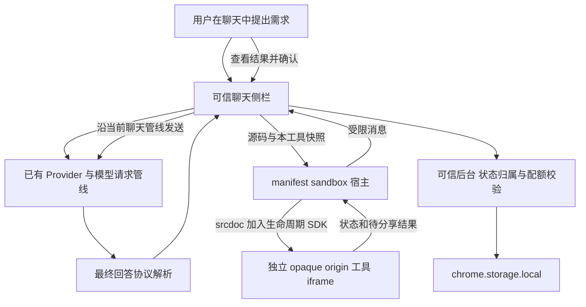
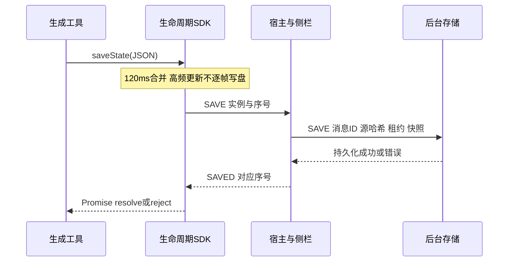

# SPACE AI 交互式 UI 实现方案

运行机制基线：SPACE AI 1.0.7，源码提交 `94a8f5d`。1.0.8已实现侧栏与工具卡片优化，运行协议沿用此基线。日期：2026-10-14。

SPACE AI 把模型返回的完整 HTML、CSS、JavaScript 变成聊天中的可操作工具。模型负责工具内部的计算、绘图和交互，扩展负责隔离运行、保存状态、展示工具控制栏，并在用户确认后把结果交回当前对话。

本文解释已经落地的实现，并单独给出图表、模拟和界面优化的后续规范。**当前运行器支持生成图表所需的浏览器能力，但没有内置一个统一图表 SDK；不同模型生成的图表交互质量仍有差异。**

需要按文件和代码落地时，先读 [在浏览器扩展中实现交互式UI](space-ai-extension-implementation-guide.md)：Manifest V3 → 侧栏 → sandbox → srcdoc → 后台存储的完整对接链路。

界面优化范围为聊天侧栏和交互工具卡片。具体布局见 [界面优化方案](plans/space-ai-ui-optimization.md)，当前与历史验证证据见 [验收记录](ai-ui.md)。

## 1. 能力范围

| 能力 | 1.0.7 实现 | 使用条件或边界 |
| --- | --- | --- |
| 完整 HTML/CSS/JS | 已实现 | 页面自包含，不能加载外部资源 |
| 按钮、输入、表单事件 | 已实现 | 使用普通 DOM；表单不能向外部提交 |
| SVG、Canvas、动画 | 已实现 | 逻辑由生成代码实现；默认暂停 |
| 聊天中直接操作 | 已实现 | 完整回复结束且通过协议检查后启动 |
| 放大和缩小 | 已实现 | 同一个 iframe 改变布局，不重新运行工具 |
| 收起和重新打开 | 已实现 | 收起先暂停、保存，重开重建页面并恢复数据 |
| 侧栏或浏览器重启恢复 | 已实现 | 依赖最近确认快照和仍存在的对话记录 |
| 解释结果、修改工具 | 已实现 | 用户通过扩展外侧按钮查看结果并确认发送 |
| 数据筛选、缩放、选区、联动图表 | 生成代码可以实现 | 尚无统一图表组件或选区协议 |
| ECharts、Chart.js 等库 | 未向原生工具开放 | 主侧栏的 vendor 不等于子 iframe 已获得该库 |
| 实时网络图表、CDN、Worker | 未开放 | 需单独设计权限与资源边界 |
| 任意 JS 堆快照、强制中断死循环 | 不提供 | 数据序列化和协作暂停不能替代进程隔离 |

## 2. 三层运行架构



### 2.1 聊天侧栏

侧栏持有模型配置、当前对话、草稿和附件。它创建工具外框、管理放大和收起、展示保存与错误状态、检查用户操作。模型代码不能修改这些外侧按钮，也不会得到模型密钥。

入口是 [panel.js](../extensions/space-browsa/ai-ui/panel.js)，聊天接入由 [ai-ui-patch.mjs](../extensions/space-browsa/ai-ui-patch.mjs) 在构建时注入上游侧栏。

### 2.2 sandbox 宿主

[native-host.html](../extensions/space-browsa/ai-ui/native-host.html) 和 [native-host.js](../extensions/space-browsa/ai-ui/native-host.js) 是扩展打包的受控页面，运行于 manifest sandbox。它们验证消息格式、实例和负载，再把允许的数据转发到外侧；生成代码运行在它们的子 iframe 中，不与宿主共享 DOM 或全局对象。

Chrome 的 [sandbox 官方说明](https://developer.chrome.com/docs/extensions/reference/manifest/sandbox) 支持独立来源和独立 CSP：sandbox 页面不能直接使用扩展 API 或访问普通扩展页面。这里的双层结构用于把生成代码与消息控制器进一步分开。

### 2.3 工具子页面

子 iframe 使用 `srcdoc`，只授予 `sandbox="allow-scripts"`，没有 `allow-same-origin`、弹窗或顶层导航权限。[runtime.mjs](../extensions/space-browsa/ai-ui/runtime.mjs) 在模型脚本之前加入 CSP 和小型 SDK，然后浏览器执行真正的 HTML/CSS/JS。

这与把字符串写进聊天页 `innerHTML` 有本质差别：聊天文档保持消毒和严格 CSP，只有隔离页面执行生成脚本。

## 3. 从模型输出到可操作页面

### 3.1 生成契约

[tool-prompt.mjs](../extensions/space-browsa/ai-ui/tool-prompt.mjs) 要求模型返回一个完整页面，使用唯一的 `space-ui` 围栏。实际模型有时返回 `html` 围栏，因此协议也接受含明确工具声明的 HTML，例如：

````markdown
```space-ui
<!doctype html>
<html lang="zh-CN">
<head>
  <meta name="space-tool" content="1">
  <title>我的交互工具</title>
  <style>/* 自包含样式 */</style>
</head>
<body>
  <!-- 工具界面 -->
  <script>/* 普通 JavaScript 和 spaceTool 接口 */</script>
</body>
</html>
```
````

普通 HTML 示例不会仅因为含 `<script>` 就执行。显式 `space-ui` 本身表示工具；`html` 需要工具 meta、SDK 调用或兼容的旧程序声明。

提示词决定生成质量，运行边界由代码和浏览器约束。不能把“提示模型不要访问网络”当成安全措施。

### 3.2 流式回复与思考内容

生成过程中仍按聊天文本展示，不执行半成品。完成后 [protocol.mjs](../extensions/space-browsa/ai-ui/protocol.mjs) 先识别最终回答，再检查围栏闭合、大小、数量，以及取消和截断标记。

1.0.7 修正了默认思考模式：`<thinking>` 等思考区中的草稿围栏不参与最终工具计数。否则模型先在思考中写一版 HTML，再正式回答，就可能被误判为两个工具。协议同时处理嵌套标签、多行标签、未闭合草稿围栏和代码里的字面字符串。

解析结果分为 `none`、`pending`、`ready`、`error`。只有 `ready` 且消息未被标记为取消或截断，才能进入运行器。侧栏和后台使用同一解析器，避免前端打开一种源码、后台却按另一种源码验证状态。

### 3.3 源码展示与执行来源

执行来源始终是解析出的原始 HTML，不从聊天中高亮后的 DOM 拼回源码。聊天的数学和代码渲染可能改变 `$` 表达式的可见文本；因此工具源码折叠前会用 `textContent` 恢复原文，再放入“查看工具源码”区域。

思考和引用中的示例排除在该恢复流程之外，避免把引用的旧示例替换成最终工具。历史和复制保留完整原始回复。

## 4. 隔离与受控通信

### 4.1 CSP 和资源

主扩展页面不为生成代码增加 `unsafe-inline` 或 `unsafe-eval`。主页面仅允许加载本地 sandbox frame；manifest sandbox 允许必要的内联脚本，子页面进一步限制资源：

```text
default-src 'none'
script-src 'unsafe-inline'
style-src 'unsafe-inline'
connect-src 'none'
img-src 'none'
font-src 'none'
frame-src 'none'
worker-src 'none'
object-src 'none'
base-uri 'none'
form-action 'none'
```

构建文档时移除模型的 `meta[http-equiv]`、`base`、外链脚本和 `link`。Canvas 和内联 SVG 可用于绘图，外部图片和字体不能加载。主页面和 sandbox 的策略分开设置，依据见 [Chrome CSP 官方说明](https://developer.chrome.com/docs/extensions/reference/manifest/content-security-policy)。

这些限制经过已列出的浏览器资源、导航和父页面探测验收，但不是任意资源耗尽攻击的硬保证。

### 4.2 消息协议

内外通信使用 `postMessage`，协议版本为 3。外侧结合 `event.source`、`origin`、当前实例随机 ID、精确字段集合和请求 ID 校验消息；`origin === 'null'` 只是 sandbox 特征，不能单独证明身份。

| 消息 | 方向 | 作用 |
| --- | --- | --- |
| `SPACE_TOOL_INIT` | 侧栏 → 宿主 | 下发原始 HTML 与本工具快照 |
| `SPACE_TOOL_READY` | 子页面 → 侧栏 | 启动反馈，不代表应用逻辑全部正确 |
| `SPACE_TOOL_SAVE` / `SAVED` | 子页面 ↔ 侧栏 | 提交有限 JSON，等待保存确认 |
| `SPACE_TOOL_SNAPSHOT` / `RESULT` | 侧栏 ↔ 子页面 | 用户分享时获取当前待分享结果 |
| `SPACE_TOOL_PAUSE` | 侧栏 → 子页面 | 请求协作式暂停 |
| `SPACE_TOOL_CLOSE` / `CLOSED` | 侧栏 ↔ 子页面 | 暂停、保存完成后关闭 |
| `SPACE_TOOL_ERROR` | 子页面 → 侧栏 | 脚本或负载错误，展示明确反馈 |

子页面没有发送聊天、读取任意存储或调用任意扩展 API 的通用消息入口。SAVE 经过宿主、侧栏和后台多次验证；后台只接受精确的本扩展 `sidepanel.html` 来源。

## 5. 状态保存与版本

### 5.1 生命周期 SDK

```js
const restored = await spaceTool.loadState();
const state = restored ?? { schemaVersion: 1, a: 2, b: 3, result: 5 };

// 应用交互后更新 state，再等待持久化确认。
await spaceTool.saveState(state);
spaceTool.setResult({ summary: `当前结果为 ${state.result}`, data: state });

spaceTool.onPause(() => {
  // 停止本应用的循环；保存承诺的拒绝必须处理。
  Promise.resolve().then(() => spaceTool.saveState(state)).catch(showSaveError);
});
```

`showSaveError` 是生成应用自行提供的错误展示函数。`loadState()` 返回应用数据，不是整个宿主存储对象；`saveState()` 会先同步校验输入，非法数据可能直接抛异常，通过校验后才返回等待存储确认的 Promise，因此示例同时捕获同步异常和异步拒绝；`setResult()` 不返回保存确认，只更新并排队保存待分享结果；`onPause()` 返回解除订阅函数。

SDK 的自动表单快照是补充：它不能替应用保存粒子速度、数据序列或图表选区。密码、文件和 hidden 输入不进入通用表单快照；生成应用仍可能自行保存普通字段，所以工具不应要求输入账户秘密。

### 5.2 数据结构

后台将本工具记录写入 `spaceToolStateV1`，大致结构如下：

```json
{
  "<spaceToolMessageId>": {
    "stateSchemaVersion": 1,
    "sourceHash": "<原始HTML的SHA256>",
    "lease": "<当前打开实例的租约UUID>",
    "state": {
      "data": { "schemaVersion": 1, "a": 2, "b": 3, "result": 5 },
      "forms": { "field-0-a": "2" },
      "result": { "summary": "2 + 3 = 5", "data": { "value": 5 } }
    }
  }
}
```

外层 `stateSchemaVersion` 属于宿主快照格式，应用 `data.schemaVersion` 属于模型自己的数据格式，两者不能混为一谈。此处 UUID 和哈希是结构说明，并非真实记录。

`spaceToolMessageId` 在 assistant 消息持久化之前生成，贯穿 DONE、当前历史和归档。`sourceHash` 绑定该消息的 HTML；每次 LOAD 签发新租约，旧实例迟到的 SAVE 被拒绝。后台串行队列与上游历史共享写锁，防止迁移或归档覆盖并发消息。

当前没有独立的“工具资料库”和显式 `revisionId` 表。一次修改产生新的 assistant 消息和 UUID，用 `spaceToolParentId` 指向原消息；新旧版本拥有各自状态。不能把早期设计中的概念字段当成已经存在的数据库字段。

### 5.3 保存时序



SDK 一次只发一个保存请求，后续修改合并等待。收起会暂停工具、刷出最后快照，收到 CLOSED 后才移除 frame。放大仅改同一个 frame 的布局。突然关闭浏览器或崩溃只能恢复最近确认快照，不能保证尚未确认的数据已经落盘。

LOAD 只针对当前对话中的合法消息。归档恢复后该消息重新进入当前历史，可再次取得状态；只要当前或归档记录仍引用消息，快照就保留，全部引用删除后回收。

## 6. 图表类工具设计

本节是生成图表的实现规范。已有动态正弦波验证了 Canvas、参数调整、运行/暂停/单步和状态恢复；缩放、刷选、多图联动等要由具体工具生成并单独验收，尚非所有图表自动具备。

### 6.1 渲染方式选择

| 场景 | 首选 | 原因与限制 |
| --- | --- | --- |
| 简单柱形、折线、少量散点 | SVG | 文字和几何清晰，便于点选和键盘等价操作 |
| 高频曲线、粒子、较密集散点 | Canvas 2D | 集中绘制，需自行实现命中检测和可访问说明 |
| 地理图、大数据、多坐标轴 | 后续打包图表库 | 先验证包体、许可、sandbox兼容和资源加载策略 |
| 3D、高负载计算 | 单独评估 | 不因浏览器有 WebGL 就承诺任意设备性能；Worker 当前禁止 |

第一版优先原生 Canvas/SVG，避免模型引入不存在的全局 `echarts` 或远程 CDN。若以后开放 ECharts，应把审计过的固定版本通过受控构建注入**工具运行边界内**；不能让模型动态传任意 URL，也不能直接复用父侧栏对象。

### 6.2 把图表拆成数据、视图与瞬态交互

```js
const chartState = {
  schemaVersion: 1,
  params: { amplitude: 1, frequency: 1 },
  view: { xMin: 0, xMax: 6.283185, yMin: -1.2, yMax: 1.2 },
  selection: null,
  hiddenSeries: [],
  animation: { phase: 0, steps: 0 },
  seed: 42
};
```

这是应用数据示例，不是新 SDK。持久化参数、视图范围、确定的选区 ID、序列显隐、相位、步数和随机种子；鼠标像素坐标、tooltip DOM、Canvas context、计时器 ID 和 ResizeObserver 不保存。

函数曲线可以由参数和相位重新计算，不必把每帧几百个重复点存入快照。不可重新生成的数据应保存有限窗口及数据来源/版本，不能从历史中静默丢弃原始样本。

### 6.3 尺寸和清晰度

容器先有有效宽高，再创建图表。使用 `ResizeObserver` 观察容器，放大、缩小或侧栏宽度改变时只更新绘图区，不重建业务状态；依据见 [ResizeObserver](https://developer.mozilla.org/en-US/docs/Web/API/ResizeObserver)。

Canvas 把 CSS 尺寸与像素尺寸分开，按 `devicePixelRatio` 设置 backing store，必要时给 DPR 设项目约定的上限。坐标统一使用 CSS 像素，再通过 context 变换绘制；不要同时缩放坐标和乘 DPR，否则会重复缩放。设置 Canvas 的 width/height 会重置绘图状态，之后重新应用变换和样式。

容器宽高为 0 时延后绘制。resize 回调中不要无条件改变被观察容器尺寸，避免循环。应以 `requestAnimationFrame` 合并布局变化，在放大后的新尺寸落定后绘制。使用 ECharts 的后续方案同样需要显式尺寸和 `resize()`，见 [Chart Container](https://echarts.apache.org/handbook/en/concepts/chart-size/)。

### 6.4 轴与数据正确性

- 绘图区单独保留轴标题、刻度和单位的边距。只在绘图区裁剪曲线，不能裁掉坐标标签。
- 轴范围根据可见有效数据和参数变化调整；振幅从 1 调为 3 时，纵轴应扩展或明确固定范围，不能让大段曲线无解释地消失。当前正弦波样例的交互通过不等于轴策略已经达到这一规范。
- 使用有限数值，拒绝 NaN/Infinity，区分缺失值与 0。时间戳的时区、金额单位和聚合方法写清楚。
- 柱图基线、对数轴、双坐标轴等选择要与任务匹配；不能为了视觉冲击改变数据含义。
- 没有数据、只有一个点、恒定序列、极端值和负值都需可理解的显示。

### 6.5 交互动作

| 动作 | 实现方式 | 需要保存的数据 |
| --- | --- | --- |
| hover提示 | pointer坐标换算为数据坐标，查最近有效点 | 不保存hover |
| 点选数据点 | SVG事件或Canvas命中检测，展示数值详情 | 稳定样本ID |
| 图例开关 | 更新可见序列集合，再重算可见范围 | 序列ID集合 |
| 滚轮/按钮缩放 | 以指针或区间中心调整domain，限制最小跨度 | x/y视图范围 |
| 拖拽平移 | 记录起始domain和指针位移，pointer capture | 拖拽结束后的domain |
| 区间刷选 | 把像素区间反算成数据区间 | 数据区间或稳定ID |
| 参数滑块 | input实时预览，change或节流后确认保存 | 参数值和必要派生状态 |
| 重置视图 | 只恢复坐标范围和选区 | 新视图，不清除数据 |
| 多图联动 | 共享一个应用state，按同一时间/样本索引更新 | 共同选择范围 |

Canvas 的坐标反算需减去绘图区偏移，并校验范围。tooltip 用文本节点显示数据，不能把用户数据拼成 HTML。拖拽结束、取消和指针丢失都清理 capture；窄侧栏保留页面纵向滚动，不让所有滚轮都被图表吞掉。缩放提供按钮或键盘等价操作。

### 6.6 性能和持久化

交互反馈、物理计算、绘制、持久化四个节奏分开。指针移动至多每绘制帧更新一次；重算按数据规模调节；状态保存不按每个采样点发送。SDK 有合并和限流，不代表应用可以无限提交完整大数组。

建议初始显示窗口控制在数百点，并依据绘图区像素宽度抽稀；这是工程起点，不是已实测吞吐保证。统计指标和选区数值仍按原始有效数据计算，不能用屏幕抽稀后的点冒充完整结果。静态网格可缓存，避免每帧重做昂贵布局，参考 [Canvas 优化指南](https://developer.mozilla.org/en-US/docs/Web/API/Canvas_API/Tutorial/Optimizing_canvas)。

### 6.7 分享图表结果

`setResult` 提供有边界的语义数据，例如：

```json
{
  "summary": "选中12至18秒，共120个有效样本，峰值3.2V",
  "data": {
    "kind": "selected-series",
    "unit": "V",
    "rangeSeconds": [12, 18],
    "sampleCount": 120,
    "stats": { "min": -2.9, "max": 3.2, "mean": 0.14 },
    "parameters": { "gain": 3 },
    "source": "用户输入的本地样本"
  }
}
```

区间、单位、样本数、过滤条件和计算方式比单张截图更有利于模型解释。是否附带小规模原始点由用户任务决定；超过消息预算应缩小选区或汇总，不静默截断。当前分享的是语义 JSON 与源码上下文，不是自动截取 Canvas 图片，也不是已有通用图表导出器。

## 7. 动画与物理模拟

已有物理样例保存重力、弹性系数、位置、速度、模拟时间和步数，重开后默认暂停。复杂星系模拟、能量守恒精度和大粒子数性能尚未逐一验收。

生成模拟时采用固定物理步长，显示由 `requestAnimationFrame` 驱动。浏览器一帧耗时不直接当成无限大的物理步长；限制累计时间与每帧子步数，避免后台切回后巨步推进。运行、暂停、单步、重置分别有明确含义。

保存参数、位置、速度、时间、种子和必要的有限历史；不保存每次绘制结果。恢复重新建立循环和事件监听，保持暂停。物理图与能量曲线共享同一次模拟状态，不能各用一套不一致的计时器。

外侧“停止”用于协作暂停普通定时器和动画。任意同步死循环无法保证被这一按钮立即中断；需要硬中断保证时，应另评估隔离引擎或进程，不能通过修改文案声称已经解决。

## 8. 结果回传和工具修改

1. 用户点击外侧“把结果发给 AI”。
2. 宿主请求当前结果，侧栏显示摘要、数据和提问区。
3. 用户选择解释或修改并确认。
4. 重新核对工具仍属于当前对话、当前页面未变、聊天未在重复发送。
5. 合并已有草稿与附件，沿既有 Provider/Model 请求管线提交一次。

源码和结果标记为不可信参考，不提升为系统指令。发送上下文包括原工具消息身份、源哈希、结果和完整工具源码；解释保留当前工具，修改要求返回完整新版。`spaceTool.setResult`、合成click和伪造消息不能直接替用户发言。

当前执行源码和结果合计另有约90,000字符的发送预算；它是应用字符预算，不是模型token窗口保证。某些模型仍可能拒绝超限上下文，应保留草稿和旧工具并明确报错。

修改版通过父消息标记和“查看原版”关联，失败不删旧版。当前不会自动迁移不同源码的应用状态；应用显式迁移和独立版本管理器属于后续范围。

## 9. 配额与错误处理

| 项目 | 当前代码限制 |
| --- | --- |
| HTML源码 | 64,000，按JS字符串长度检查 |
| SDK序列化快照 | 约60,000字符 |
| 保存包 | 128KiB，UTF-8 JSON字节 |
| 结果经过宿主 | 12,000字节；侧栏另做12,000字符检查，以较早触发者为准 |
| SDK结果摘要 | 4,000字符 |
| 全部工具状态 | 2MiB |
| JSON结构 | 最大深度16、约10,000节点、数组最多5,000且稠密 |
| 自动表单 | 最多取200个候选字段；单字段字符串最多4,096字符 |
| 宿主保存 | 一个在途请求，每秒最多20次 |
| SDK合并 | 120ms；保存确认超时5秒 |
| 外侧命令 | 等待约5.5秒；启动约6秒看门狗 |

这些是多层上限，不是可累加的容量承诺。中文等内容的UTF-8字节长度可能先触发宿主预算。图表建议保存可重建的小状态，必要时先缩小可分享范围。

当前脚本异常会持续展示，不会被一次成功自动保存覆盖。1.0.8已把运行状态与保存状态分开：已经保存不等于脚本仍正常；收到READY也不等于计算结果正确。

超限、存储失败、陈旧租约、来源哈希变化、丢失对话归属、脚本错误和模型截断必须有不同处理。缺失状态可以使用默认值；不兼容状态不能静默塞进新版；源不匹配应停止恢复。

## 10. 当前界面问题与优化原则

1.0.7 的功能控制已经存在，但多数是等权重原生按钮。状态、版本、重启、重置和分享排列在一起；固定520px的frame在窄窗口显得拥挤，放大外框和sandbox宿主又硬编码白色，和深色工具不协调。聊天快捷栏中的“AI UI”只追加长提示词，界面难以说明当前生成意图。

优化应集中在：工具标题和状态清晰、主要操作固定位置、高风险动作收进更多菜单、图表先得到空间、源码变成次级信息、错误与保存反馈分开。外侧不能通过同源DOM访问去强制改写生成工具的内部布局；图表轴、配色和按钮设计需由生成规范或未来受控模板改善。

不把已有SVG/Canvas图表都换成统一宿主预设应用，否则会削弱模型根据问题生成交互逻辑的目标。

## 11. 文件地图

| 文件 | 职责 |
| --- | --- |
| [ai-ui-patch.mjs](../extensions/space-browsa/ai-ui-patch.mjs) | 上游侧栏接入、构建文件、CSP和外侧样式 |
| [protocol.mjs](../extensions/space-browsa/ai-ui/protocol.mjs) | 识别最终工具、思考剥离、完成与大小检查 |
| [panel.js](../extensions/space-browsa/ai-ui/panel.js) | 工具外框、同实例放大、收起、源码和分享审阅 |
| [panel.css](../extensions/space-browsa/ai-ui/panel.css)、[sidebar.css](../extensions/space-browsa/ai-ui/sidebar.css) | 1.0.8工具卡片、解除消息包含限制、侧栏导航与主题样式 |
| [native-host.js](../extensions/space-browsa/ai-ui/native-host.js) | 两个来源间的受限消息转发和负载检查 |
| [runtime.mjs](../extensions/space-browsa/ai-ui/runtime.mjs) | 注入SDK、生成文档、保存合并与协作暂停 |
| [tool-state.mjs](../extensions/space-browsa/ai-ui/tool-state.mjs) | 后台状态、消息身份、源哈希、租约、配额和回收 |
| [tool-state-patch.mjs](../extensions/space-browsa/tool-state-patch.mjs) | 历史/归档ID与共享写锁接入 |
| [tool-revisions-patch.mjs](../extensions/space-browsa/tool-revisions-patch.mjs) | 父工具关系与发送检查 |
| [tool-prompt.mjs](../extensions/space-browsa/ai-ui/tool-prompt.mjs) | 给模型的原生工具生成约定 |
| [build-browsa.mjs](../scripts/build-browsa.mjs) | 固定上游导出、顺序补丁、配方哈希、打包 |
| [legacy-panel.js](../extensions/space-browsa/ai-ui/legacy-panel.js) | 旧JSON/声明式工具兼容，不等同于新运行器 |

所有适配继续改可追踪配方，不改上游缓存、当前安装目录或已交付的1.0.7产物。

## 12. 验证和交付

1.0.7 已有验收记录为160项单测、20项实际扩展浏览器测试和72项构建时上游回归。真实默认思考响应已保留原样fixture；计算器、动态图表、物理模拟覆盖操作、放大、重开、归档和浏览器重启。结果发送/修订的完整回归使用本地模型服务。具体外部模型和回放的区别见 [验收记录](ai-ui.md)，不能把全部浏览器回归称为全部外部模型联调。

```sh
npm run check
npm test
npm audit --audit-level=moderate
npm run browsa:build
CHROMIUM_PATH='<本机测试浏览器>' npx playwright test \
  tests/e2e/ai-tools-thinking.spec.ts \
  tests/e2e/ai-tools-model.spec.ts \
  tests/e2e/ai-tools-flow.spec.ts \
  tests/e2e/ai-tools.spec.ts
```

构建拒绝覆盖已有同版本包；复测前保留旧产物，新交付正式升版。1.0.8新增键盘、窄窗口、深浅主题、菜单、放大焦点恢复与失败重置验收，同时保留现有安全与历史回归。本次160项单测、24项浏览器测试、72项构建回归通过，详见验收记录；未重新调用外部模型，使用已有原样输出和本地SSE服务。

## 13. 后续分期

| 阶段 | 内容 | 交付门槛 |
| --- | --- | --- |
| 界面优化 | 1.0.8已实现聊天侧栏、工具卡片、状态、分享面板、窄窗口与深浅主题 | 本次实际扩展浏览器验收通过 |
| 图表规范 | 轴范围、单位、ResizeObserver、数据选区、有限序列和无障碍 | 用真实生成样例验证每个新增交互 |
| 可选图表库 | 固定版本本地打包、许可、工具内注入和兼容层 | 单独通过资源边界和包体/性能验收 |
| 外部数据 | 明确域名/数据范围的用户授权代理 | 独立权限方案；不开放通用网络或密钥访问 |

第一阶段不承诺自动修复所有模型内部UI或数值算法。完成的是可信外框体验和更明确的生成指导，模型页面仍须按任务验证。
